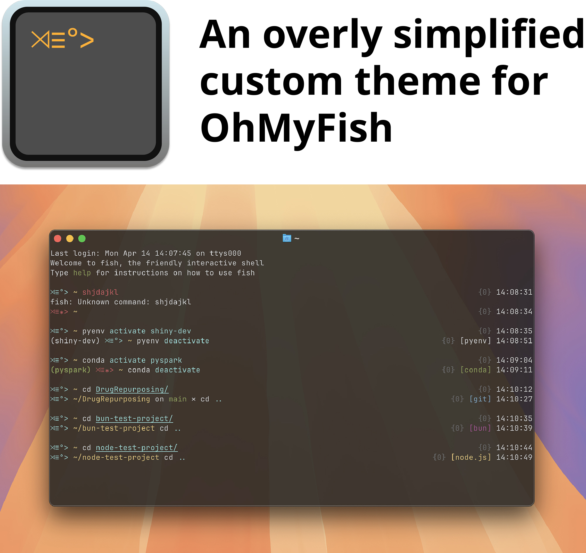

# 'Keep The Fish Alive' custom theme for OhMyFish
My own take on the default [OhMyFish theme](https://github.com/oh-my-fish/oh-my-fish/blob/master/docs/Themes.md): it turns `⋊> ~` into `⋊≡°> ~`. Moreover, it turns into `⋊≡⁎> ~` after an error -mimicking a dead fish- and it adds standardised information on project directories (<i>i.e.</i> git, node.js and bun) and virtual environments (<i>i.e.</i> Python venv, conda env).



This theme was optimised for the [Ghostty](https://ghostty.org) terminal emulator, with the 'Afterglow' color theme.

## Requirements
The [fish](https://fishshell.com) shell and [Oh My Fish](https://github.com/oh-my-fish/oh-my-fish) (omf):

| | fish | omf |
|---|---|---|
| macOS | `brew install fish` ([homebrew](https://brew.sh)) | `curl https://raw.githubusercontent.com/oh-my-fish/oh-my-fish/master/bin/install \| fish` |
| Arch Linux | `sudo pacman -S fish` | `curl https://raw.githubusercontent.com/oh-my-fish/oh-my-fish/master/bin/install \| fish` (or the AUR package `oh-my-fish`) |

## Installation (MacOS, Linux)
Clone the repository directly into omf's themes directory: `~/.local/share/omf/themes/` (more precisely `$OMF_PATH/themes/`, which differs only if `$XDG_DATA_HOME` or `$OMF_PATH` were changed).

```fish
git clone https://github.com/NCMBianchi/keep_the_fish_alive.git $OMF_PATH/themes/keep_the_fish_alive
omf theme keep_the_fish_alive
```

To update:
```fish
git -C $OMF_PATH/themes/keep_the_fish_alive pull
exec fish
```

> `omf install https://github.com/NCMBianchi/keep_the_fish_alive` does not work yet: for URLs, omf only recognises a theme if `fish_prompt.fish` is at the repository root, otherwise it installs it as a plugin. Once the theme is listed in the [official omf package repository](https://github.com/oh-my-fish/packages-main), `omf install keep_the_fish_alive` will work.

## Tests
Tests use [fishtape](https://github.com/jorgebucaran/fishtape) (`fisher install jorgebucaran/fishtape`):
```fish
fishtape tests/*.test.fish
```

## License
This project is licensed under the MIT License. Feel free to use and modify the code as per your needs.
